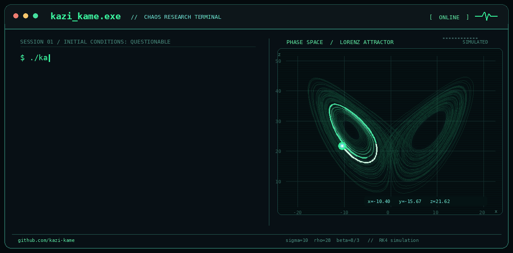

<!--
  PROFILE README FOR github.com/kazi-kame
  Put this file in the root of a PUBLIC repository named "kazi-kame".
  Keep assets/chaos-terminal.gif alongside it.
  Generate a new animation with: python tools/render_chaos_terminal.py
-->

  

  बकचोद

  <a href="#research">Research</a> &nbsp;\u00b7&nbsp;
  <a href="#things-ive-built">Projects</a> &nbsp;\u00b7&nbsp;
  <a href="#toolkit">Toolkit</a> &nbsp;\u00b7&nbsp;
  <a href="https://github.com/kazi-kame?tab=repositories">All repositories</a>

---

### `> whoami`

I'm **Kazi** (Anas Kazi), a physics undergrad at **Fergusson College, Pune**, also studying **data science through IIT Madras**.

I use mathematics, simulations, and data to study systems.

I'm especially interested in the gap between a *numerical result* and a *physical conclusion*. If a pattern disappears under validation, it's not a discovery, its just another month wasted.

### Research

| System | What I'm investigating |
| :--- | :--- |
| **[Saturn-like atmospheric jets](https://github.com/kazi-kame/Saturn-like-jets-in-a-global-shallow-water-model)** | Global shallow-water dynamics, prescribed zonal jets, linear instability, and short-time forced response. *Not a claim of demonstrated long-term polygon formation.* |
| **Low-Earth-orbit debris** \u00b7 ongoing research | Orbital histories, periodicity, and stochastic models for drag-driven orbital evolution. |
| **[Quantum billiards](https://github.com/kazi-kame/QuantumLab)** | Numerical eigenmodes and time evolution in stadium-shaped quantum billiards, including scar-like structures. |

### Things I've built

| Repository | What it does |
| :--- | :--- |
| **[MandelWalk](https://github.com/kazi-kame/MandelWalk)** | Explore the Mandelbrot set as a navigable, GPU-rendered environment instead of a static 2D zoom. |
| **[Chaos-Tracker](https://github.com/kazi-kame/Chaos-Tracker)** | Track a real double pendulum with computer vision and reconstruct its chaotic motion. |
| **[Double Pendulum Simulator](https://github.com/kazi-kame/double-pendulum-sim-game)** | Interactively simulate deterministic chaos and estimate the largest Lyapunov exponent. |
| **[QuantumLab](https://github.com/kazi-kame/QuantumLab)** | Compute and visualize spectral behavior in a quantum stadium billiard. |

### Toolkit

`Python` \u00b7 `NumPy` \u00b7 `SciPy` \u00b7 `Matplotlib` \u00b7 `Pygame` \u00b7 `Dedalus` \u00b7 `Git` \u00b7 `Linux`

**Topics I keep coming back to:** nonlinear differential equations, dynamical systems, numerical methods, stochastic processes, scientific visualization, and computational physics.

---

  <samp>Make a model. Break the model. Understand what survived.</samp>

